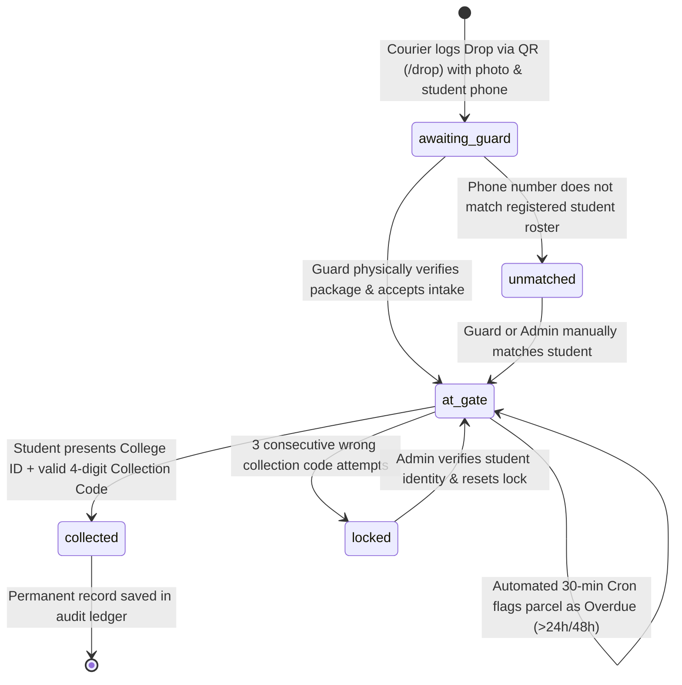

# 📦 GateKept — Campus Hostel Parcel Security & Logistics Management System

<div align="center">

[](https://react.dev/)
[](https://vitejs.dev/)
[](https://tailwindcss.com/)
[](https://nodejs.org/)
[](https://expressjs.com/)
[](https://www.mongodb.com/)
[](https://cloudinary.com/)
[](LICENSE)

**"Never leave parcels lying unattended at the hostel gate again."**  
*A bulletproof, zero-trust campus parcel custody system bridging delivery agents, hostel guards, students, and wardens.*

[Key Features](#-key-features) • [System Architecture](#-system-architecture) • [Parcel Lifecycle](#-parcel-lifecycle) • [Installation & Setup](#-installation--setup) • [Demo Credentials](#-seeded-demo-credentials) • [API Reference](#-api-endpoints)

</div>

---

## 🧭 The Problem & The Solution

| The Chaos Before GateKept | The Discipline With GateKept |
|---|---|
| ❌ Delivery agents dump parcels outside the gate on tables or the floor. | 🔒 Delivery agents scan a gate QR and log arrival with photo proof & student phone. |
| ❌ Anyone can pick up, misplace, or steal packages without a trace. | 🛡️ Guard checks package integrity and logs intake into the secured gate locker. |
| ❌ Students get zero official notification when a parcel reaches the campus. | 📲 Instant student notifications & dashboard updates with a secret 4-digit code. |
| ❌ Disputes between students, guards, and delivery personnel have no audit trail. | 📑 Every handoff is cryptographically logged with actor IDs, IP timestamps, and audit logs. |

---

## 🎨 UI/UX Design System: *Neo-Brutalist Customs Aesthetic*

GateKept is crafted with a high-impact, industrial **Neo-Brutalist Customs & Security Desk** theme:
- **Tactile Material Palette**: Physical cardboards, Manila paper (`#F4F1EA`), ink-black borders (`#16150F`), safety signal orange (`#FF5B1F`), and customs rubber stamps.
- **Physical Parcel Metaphors**: Digital shipping tags (`ShippingTag`), perforated coupon edges, physical verification stamps (`COLLECTED`, `OVERDUE`, `STORED`), and barcode simulations.
- **Typography**: Engineered monospace labels (`JetBrains Mono`) paired with bold editorial sans-serif (`Bricolage Grotesque`).
- **Tactile Micro-interactions**: Hard offset shadows (`box-shadow: 4px 4px 0 #16150F`) with snappy button depressions on press.

---

## ⚡ Key Features

### 1. 🚚 Public QR Courier Drop Form (`/drop`)
- **Frictionless Driver Experience**: No login required. Delivery drivers simply scan the physical gate QR code with their smartphone.
- **Instant Optical Evidence**: In-app parcel photo capture/upload compressed on the client before being synced to Cloudinary.
- **Auto-Matching Engine**: Automatic normalization of 10-digit Indian mobile numbers (`+91` / `0` prefix stripping) matched against registered students.
- **Spam & Abuse Protection**: Cloudflare Turnstile CAPTCHA validation and rate limiting.

### 2. 🛡️ Guard Station & Handover Checkpoint (`/guard`)
- **Live Gate Queue**: Split views for `Awaiting Physical Intake`, `Stored At Gate`, `Collected Today`, and `Unmatched / Flagged`.
- **Intake Verification**: Guard physically verifies the parcel package against the digital entry and stamps it into storage (`at_gate`).
- **Cryptographic Collection Handoff**: Student presents college ID + their secret 4-digit Collection Code.
- **Anti-Brute Force Protection**: 3 wrong code attempts automatically locks the parcel; unlocking requires administrative clearance.

### 3. 🎓 Student Parcel Locker (`/student`)
- **Real-Time Parcel Tracking**: Live polling of incoming, stored, and historical parcel collections.
- **Secure Collection Pass**: Dynamic digital parcel pass with courier badge, timestamp, high-res intake photo, and secret collection code.
- **Campus Email Verification**: Registration gated exclusively to authorized institutional email domains (e.g. `@iiitdwd.ac.in`).

### 4. 🏛️ Warden & Admin Control Tower (`/admin`)
- **Real-Time Operational Metrics**: Total throughput, storage occupancy, average turnaround SLA, and overdue count.
- **Immutable Security Audit Log**: Every login, intake, verification attempt, handover, and override is permanently recorded with actor identity and IP address.
- **Unmatched Parcel Resolver**: Resolve unknown parcels by manual student assignment or contact verification.
- **Automated Overdue Escalation Engine**: Automated cron service identifies parcels sitting in custody over 24/48 hours and fires reminder emails.

---

## 🔄 Parcel Lifecycle



---

## 🏗️ System Architecture

```
GateKept/
├── client/                     # Frontend Application (React 19 + Vite 8)
│   ├── src/
│   │   ├── components/         # Neo-brutalist UI primitives (Button, ShippingTag, Stamp, Modal)
│   │   ├── hooks/              # Custom React hooks (usePolling, etc.)
│   │   ├── lib/                # API client, auth context, image compression utils
│   │   ├── pages/              # DropPage, GuardDashboard, StudentDashboard, AdminDashboard
│   │   └── styles/             # Tailwind CSS & design tokens
│   ├── index.html              # HTML root template
│   ├── tailwind.config.js      # Custom theme colors, shadows, and typography
│   └── vite.config.js          # Vite config & API reverse proxy
│
├── server/                     # Backend API (Node.js 24 + Express 5)
│   ├── src/
│   │   ├── config/             # MongoDB Atlas connection & environment validator
│   │   ├── controllers/        # Auth, Drop, Parcel, Admin route controllers
│   │   ├── jobs/               # Node-cron background jobs (overdue parcel reminders)
│   │   ├── middleware/         # JWT auth, role RBAC, rate limiter, error sanitizers
│   │   ├── models/             # Mongoose schemas: User, Parcel, Otp, AuditLog
│   │   ├── routes/             # RESTful API route definitions
│   │   ├── services/           # Cloudinary uploader, Nodemailer email notifier, OTP service
│   │   └── utils/              # Phone sanitizer, Turnstile verifier, 4-digit code generator
│   ├── app.js                  # Express application setup & middleware stack
│   └── server.js               # HTTP listener & database connection lifecycle
│
├── scripts/
│   ├── iiitdwd_students_all.json # Real IIIT Dharwad batch directory roster
│   └── seed.js                 # Database seeder (Admin, Guards, 50 Students & Parcels)
│
├── .env.example                # Template for environment configuration
└── README.md                   # System documentation
```

---

## 🚀 Installation & Setup

### Prerequisites
- **Node.js**: v18.x or v20+ / v24+
- **npm**: v9+ or **pnpm**
- **MongoDB**: MongoDB Atlas Cluster (free tier) or local MongoDB instance

---

### Step 1: Clone Repository
```bash
git clone https://github.com/your-username/GateKept.git
cd GateKept
```

---

### Step 2: Configure Environment Variables
Copy `.env.example` to `.env` in the root (or inside `server/`):
```bash
cp .env.example .env
```

Edit `.env` with your credentials:
```env
# Server Configuration
PORT=5000
NODE_ENV=development
CLIENT_URL=http://localhost:5173

# Database (MongoDB Atlas URI or leave empty for embedded in-memory DB)
MONGO_URI=mongodb+srv://<username>:<password>@cluster0.ujoxs0s.mongodb.net/gatekept?retryWrites=true&w=majority

# Authentication
JWT_SECRET=super-secure-production-random-secret-key-gatekept-campus
JWT_EXPIRES_IN=7d

# Allowed Institutional Email Domains (Comma-separated)
COLLEGE_EMAIL_DOMAIN=iiitdwd.ac.in,campus.edu

# Cloudinary (Optional in dev - fallback mock storage provided)
CLOUDINARY_CLOUD_NAME=your_cloud_name
CLOUDINARY_API_KEY=your_api_key
CLOUDINARY_API_SECRET=your_api_secret

# SMTP / Email Alerts (Optional in dev - console mock logger provided)
SMTP_HOST=smtp.gmail.com
SMTP_PORT=587
SMTP_USER=
SMTP_PASS=
SMTP_FROM="Gatekept Gate Security" <parcels@gatekept.campus>

# Cloudflare Turnstile (Optional in dev - auto-bypassed when empty)
TURNSTILE_SECRET_KEY=
```

---

### Step 3: Install Dependencies

```bash
# Install server dependencies
cd server
npm install

# Install client dependencies
cd ../client
npm install

cd ..
```

---

### Step 4: Seed Database with Demo Records
The repository includes an intelligent database seeder that creates admins, guards, real student accounts, and active parcels in varied lifecycle stages:
```bash
node scripts/seed.js
```

---

### Step 5: Start Development Servers

Open two terminal tabs:

**Terminal 1 — Backend API:**
```bash
cd server
npm run dev
# Server will listen on http://localhost:5000
```

**Terminal 2 — Frontend Client:**
```bash
cd client
npm run dev
# Client will be live at http://localhost:5173
```

---

## 🔑 Seeded Demo Credentials

| Role | Email | Password | Permissions |
|---|---|---|---|
| **System Admin** | `admin@iiitdwd.ac.in` | `password123` | Full control tower, audit logs, metrics, user management |
| **Warden Office** | `admin@campus.edu` | `password123` | Administrative oversight & manual resolution |
| **Gate Guard 1** | `guard1@iiitdwd.ac.in` | `password123` | Intake verification, parcel storage, collection handoffs |
| **Gate Guard 2** | `guard2@iiitdwd.ac.in` | `password123` | Desk operations |
| **Student** | `24bcs140@iiitdwd.ac.in` | `password123` | View personal parcels, collection passes & 4-digit codes |

> *Tip: Any student in `scripts/iiitdwd_students_all.json` can also log in using their college email and password `password123`.*

---

## 📡 API Endpoints

### 🔐 Authentication (`/api/auth`)
| Method | Endpoint | Access | Description |
|---|---|---|---|
| `POST` | `/api/auth/register` | Public | Register student with institutional domain check & OTP dispatch |
| `POST` | `/api/auth/verify-otp` | Public | Verify OTP code and activate student account |
| `POST` | `/api/auth/login` | Public | Login with email & password; sets HTTP-only JWT cookie |
| `POST` | `/api/auth/logout` | Authenticated | Invalidate auth session |
| `GET` | `/api/auth/me` | Authenticated | Retrieve current session profile & role |

### 📦 Public Drop Desk (`/api/drop`)
| Method | Endpoint | Access | Description |
|---|---|---|---|
| `POST` | `/api/drop` | Public | Submit new parcel drop (photo, courier, student phone, note) |

### 🏷️ Parcel Operations (`/api/parcels`)
| Method | Endpoint | Access | Description |
|---|---|---|---|
| `GET` | `/api/parcels/my` | Student | List active & past parcels for the logged-in student |
| `GET` | `/api/parcels/desk` | Guard / Admin | Fetch all parcels queued for guard desk with status filters |
| `POST` | `/api/parcels/:id/verify-intake` | Guard / Admin | Accept package intake from courier into gate locker (`at_gate`) |
| `POST` | `/api/parcels/:id/verify-code` | Guard / Admin | Verify 4-digit collection code & mark parcel collected |
| `POST` | `/api/parcels/:id/manual-collect` | Admin | Administrative override collection without student code |
| `POST` | `/api/parcels/:id/match-student` | Guard / Admin | Re-link unmatched parcel to a registered student record |

### 🛡️ Administration & Oversight (`/api/admin`)
| Method | Endpoint | Access | Description |
|---|---|---|---|
| `GET` | `/api/admin/metrics` | Admin | System statistics, turnaround times, storage load, overdue counts |
| `GET` | `/api/admin/audit-logs` | Admin | Immutable system audit trails with actor, action & timestamps |
| `GET` | `/api/admin/users` | Admin | Query users, filter by role (`student`, `guard`, `admin`) |
| `POST` | `/api/admin/users` | Admin | Provision new guard or warden administrator accounts |
| `POST` | `/api/admin/trigger-reminders` | Admin | Manually trigger overdue reminder notification engine |

---

## 🔒 Security & Anti-Fraud Architecture

- **Domain-Gated Registration**: Whitelist enforcement ensures only users with approved institutional email extensions (e.g. `@iiitdwd.ac.in`) can register.
- **Brute-Force Code Lockout**: 4-digit collection codes are rate-limited. Exceeding 3 incorrect attempts locks the parcel to prevent guessing attacks.
- **Express 5 & NoSQL Injection Protection**: Custom request sanitizers purge `$` operators and nested prototype injections across body, params, and query strings.
- **Role-Based Access Control (RBAC)**: Fine-grained middleware gates endpoints strictly according to `student`, `guard`, or `admin` scopes.
- **Rate-Limiting Shields**: Individualized rate limit windows for authentication attempts (`30 req / 15 min`) and courier drops (`60 req / 10 min`).
- **Audit Traceability**: Every status change stores the executing guard's ID, student ID, IP address, and timestamp.

---

## 🛠️ Tech Stack Breakdown

### Frontend
- **React 19**: Modern component architecture with concurrent rendering.
- **Vite 8**: Ultra-fast module bundling and hot module replacement.
- **Tailwind CSS 3.4**: Neo-brutalist custom theme tokens and utilities.
- **React Router 7**: Declarative role-protected routing.
- **Axios**: HTTP client configured with credentials and interceptors.

### Backend
- **Node.js 24 + Express 5**: Next-generation web framework handling REST APIs.
- **Mongoose 9**: Strictly-typed document modeling and compound indexing.
- **JWT + Cookie-Parser**: Secure stateless token authentication.
- **Bcrypt.js**: Salted password hashing (10 rounds).
- **Node-Cron**: Automated 30-minute background job runner for overdue notifications.

### Storage & Third-Party Integrations
- **MongoDB Atlas**: Cloud-hosted NoSQL cluster with high availability.
- **Cloudinary CDN**: Automated image transformations, WebP compression, and secure cloud storage.
- **Nodemailer**: SMTP email transport for OTPs and overdue alerts (with zero-config fallback logger).
- **Cloudflare Turnstile**: Modern bot defense for public delivery forms.

---

## 🤝 Contributing

Contributions, bug reports, and suggestions are warmly welcomed!
1. Fork the Project
2. Create your Feature Branch (`git checkout -b feature/AmazingFeature`)
3. Commit your Changes (`git commit -m 'Add some AmazingFeature'`)
4. Push to the Branch (`git push origin feature/AmazingFeature`)
5. Open a Pull Request

---

## 📄 License

Distributed under the **ISC License**. See `LICENSE` for more information.

---

<div align="center">
<b>GateKept</b> — Engineered with precision for campus security, peace of mind, and zero missing parcels.
</div>
